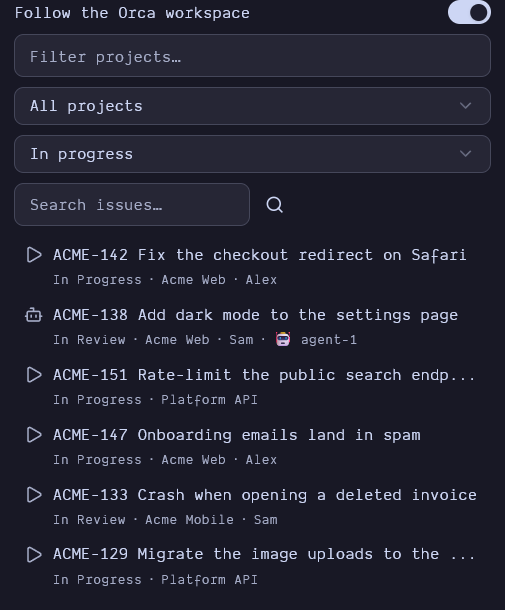
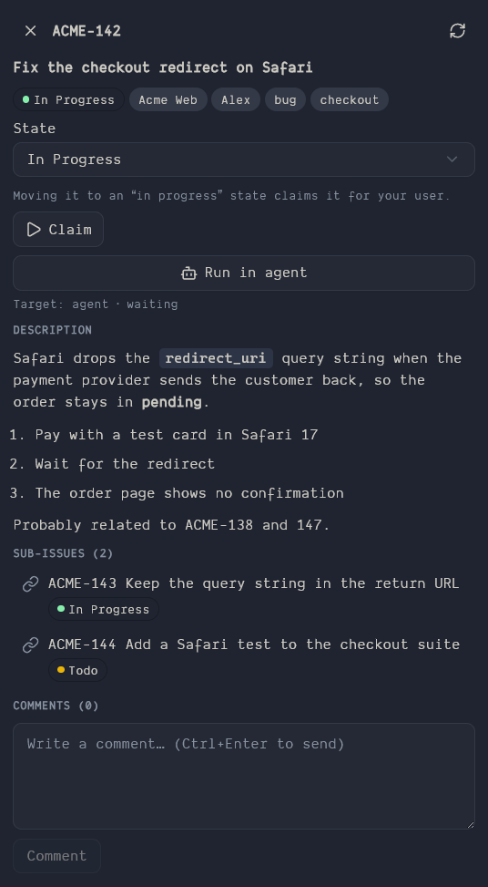

# Hilbana for Orca

[](https://github.com/hilbana/orca-plugin/actions/workflows/ci.yml)

Your [Hilbana](https://hilbana.com) issues inside [Orca](https://github.com/stablyai/orca): a sidebar panel to browse, search and update issues, plus a status bar counter of what is in progress.

It needs a [Hilbana](https://hilbana.com) account, and there is a free plan: see [New to Hilbana?](#new-to-hilbana).

| Browse and search | Issue detail |
| --- | --- |
|  |  |

*Screenshots use invented data.*

## Features

- **Browse** issues by workspace, project and state: in progress, not started, all open, all (including closed), any category, or one specific state.
- **Search** like the Hilbana web app, live as you type: local matching by identifier and title (`2139`, `drapps2139` and `DRAPPS-2139` all find the same issue) combined with Hilbana's full-text search, across every state.
- **Issue detail**: description and comments in Markdown, newest comment first, with the comment box above them.
- **Act on issues**: change state, claim or release, and comment. Moving an issue to an "in progress" state claims it for your user (the same lock as `claim_issue`).
- **Jump between issues**: related issues and issues mentioned in the description or comments are listed and clickable, and *Back* retraces your path.
- **Follow Orca's workspace**: when you switch workspace in Orca, the panel selects the matching Hilbana workspace and project. It looks, in order, at (1) the issue named by the branch (`drapps-2139-some-slug` → `DRAPPS-2139`, which it also opens), (2) the workspace and project you picked by hand for that Orca workspace, which it remembers, and (3) a name match (`acme-shop.com` → the project `acme-shop`). It never guesses between equally good matches. Turn it off with the *Follow the Orca workspace* switch.
- **Run in agent**: a button in every issue that types a prompt into the agent running in Orca's focused workspace. By default it sends the Hilbana plugin command, `/hilbana:trabajar-issue DRAPPS-123`; change it with the *Prompt sent to the agent* setting (`{identifier}` is replaced by the issue identifier, and other agents can use plain text). If several agents are running you pick the target, and the button stays disabled while the agent is working or waiting for permission, so it never interrupts it.
- **Status bar**: the number of issues in progress.
- **English and Spanish**: the panel follows Orca's UI language.

Launching a worktree and an agent straight from an issue is planned for a later release.

## New to Hilbana?

[Hilbana](https://hilbana.com) is a project tracker where **people and AI agents share one board**. Sign-up is open and needs no card: new accounts start with a 14-day Pro trial and then stay on the **Free plan**. [Create your account](https://app.hilbana.com/signup) and you can have an agent working on your issues in about ten minutes ([quickstart](https://hilbana.com/en/docs/quickstart/)). This plugin is free and MIT-licensed.

Why it works well with agents:

- **One board for everyone.** People and agents read the same issues and work under the same rules, and what each one did is recorded in the same place.
- **Claim and release.** An agent takes an issue with a lock, so two agents (or an agent and you) don't pick up the same task. You see it in progress live: that is the 🤖 marker in this panel.
- **Context on every task.** An issue can carry what an agent needs to start, plus a definition of done, so a task can be picked up without asking you.
- **A work queue.** Agents pull the next ready task instead of waiting to be told.
- **Memory between sessions.** Agents can save and recall per-project memory, so they stop starting from scratch.
- **An open protocol.** Hilbana exposes an MCP server, so any MCP-compatible agent can connect. The API key can be limited to one workspace or one project, and made read-only.
- **You pay for people, not for agents.** An agent works with an API key, and that key does not take a seat; the agent allowance is separate from the member limit. The Free plan includes one agent key, and paid plans have no limit ([plans](https://hilbana.com/en/docs/billing/)).
- **Your data stays yours.** GDPR-compliant, with a full export.

From Orca, this plugin shows which issues an agent is working on, and **Run in agent** sends the Hilbana command to your agent in one click.

Learn more: [Agents](https://hilbana.com/en/docs/agents/) · [API & MCP](https://hilbana.com/en/docs/api-mcp/) · [Quickstart](https://hilbana.com/en/docs/quickstart/) · short videos: [a task your agent finishes without asking](https://hilbana.com/en/videos/issue-lista-para-agente/), [agents don't take a seat](https://hilbana.com/en/videos/agentes-sin-asiento/).

## How it works

Orca's panel has no network access. Everything goes through the plugin's worker, which talks to Hilbana's MCP endpoint (`/mcp`, JSON-RPC over HTTP) with `Authorization: Bearer hil_…`. There are no dependencies and no build step.

## Security

- **There are no credentials in this repository.** Each person pastes their own API key in the panel.
- The key is stored in Orca's encrypted keyring (`secrets:own`), not in settings or storage.
- It is validated against Hilbana before it is saved, and it is only ever sent to the configured server URL (`https://`; `http://` only for localhost).
- To **only browse** issues, a read-only API key is enough. Changing state, claiming/releasing and commenting need a key with write permissions; with a read-only key the plugin says so.
- It is a `trusted-worker`: it runs with your user's permissions. Review the code before approving it.

Requested capabilities: `settings:own`, `secrets:own`, `storage:own`, `workspace:read` (the focused workspace's branch), `agent:read` (which agents are running and whether they are idle) and `terminal:send` (to type the prompt into the agent you choose; it only sends when you press the button, a single line, to an idle agent).

## Install

In Orca: **Settings → Plugins → Add plugin → From Git URL**, and enter `https://github.com/hilbana/orca-plugin`. Requires Orca ≥ 1.4.250 and a Hilbana API key. The Free plan includes one agent key, and this plugin only needs a key, so you can use the one your agent already uses. To pin a release, add its tag: `https://github.com/hilbana/orca-plugin#v0.5.0`. Releases are listed in [CHANGELOG.md](CHANGELOG.md).

## Development

```sh
orca plugin dev watch .
orca plugin test .
orca plugin check .
```

## License

MIT
